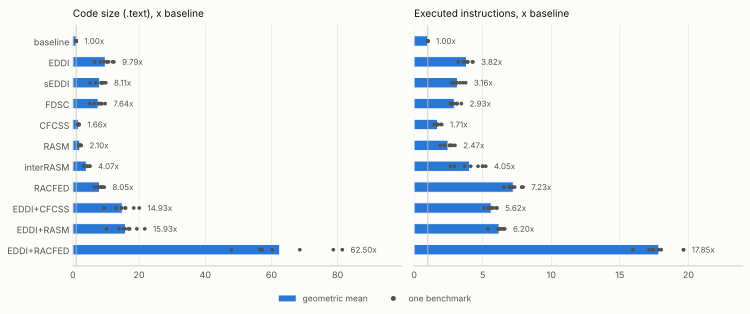
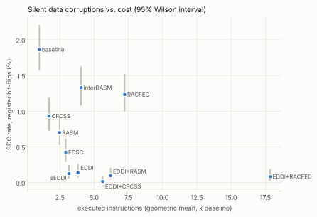

# Summary

ASPIS is an out-of-tree LLVM plugin that hardens programs against
radiation-induced soft errors by duplicating the computation (EDDI and its
variants) and by checking the control flow with signatures (CFCSS, RASM,
inter-RASM, RACFED). The goals of the project were (1) to protect C
applications with ASPIS, (2) to verify the protection with fault injection and
(3) to integrate the applications into the ASPIS main branch for regression
testing. This report describes what was done for each goal:

- **22 benchmarks** written for the purpose: 8 self-checking applications
  (AES-128, a binary search tree, an expression compiler with a virtual
  machine, an FFT, Huffman coding, an LU solver, a PID controller and a Sobel
  filter) and 14 microbenchmarks, each one stressing a feature of C that the
  passes have to handle (function pointers called back by libc, variadic
  functions, structs passed by value, VLAs, setjmp/longjmp, bit-fields, ...).
- **A compatibility campaign** that compiles every benchmark with the 55
  combinations of data protection and control-flow checking of the official
  test harness. On the main branch of ASPIS 435 (36%) of the 1210
  hardened builds produce the right output; the others do not compile, make
  the compiler hang, crash, or report faults that never happened.
- **23 defects found and fixed**, 22 in the passes of ASPIS and one in the
  TypeDeductionAnalysis library it uses, organised as a series of 19 commits
  ready for the main branch; the fixes come with 14 minimal reproducers of a
  few lines of C each, and the last defect was found by the fault injection. With the series all the 1210 builds pass, the existing
  ASPIS tests still pass (2453/2453), and 23 combinations that were
  blacklisted in the test suite now pass too.
- **A fault injector** for x86-64 Linux binaries that injects register
  bit-flips, inverted branches and wrong jump targets, stopping the program at
  a random dynamic instruction with a hardware breakpoint; and **a campaign of
  240,900 injections** (8 applications, 11 hardening configurations, 3 fault
  models, 1000 faults each, 300 for the slowest application) that measures
  how much each technique reduces the
  silent data corruptions, at which cost.

{{FI_SUMMARY}}

All the code, the raw results and the scripts that produce every table and
figure of this report are in the repository (`ASPIS-Project/`, see
Appendix A). The use of a large language model in the project is declared in
Section 9.

# 1. Background

## 1.1 Soft errors and software-implemented fault tolerance

A particle strike can flip a bit in a register, in a pipeline latch or in a
memory cell: the fault is transient, the hardware is not damaged, but the
program may compute a wrong result without noticing it (a *silent data
corruption*, SDC), crash, or hang. Software-Implemented Hardware Fault
Tolerance (SIHFT) protects programs running on unprotected hardware by
transforming the code: *data-flow* techniques duplicate the computation and
compare the copies at selected points, *control-flow checking* (CFC)
techniques assign a signature to each basic block and verify at run time that
the blocks are executed in an order allowed by the control-flow graph.

## 1.2 ASPIS

ASPIS (*Automatic Software-based Protection and Integrity Suite*,
Baroffio et al., ACM TODAES 2024, doi:10.1145/3660524) implements these
transformations as LLVM passes on the IR. The `aspis.sh` driver compiles all
the sources to IR at `-O0`, links them, and runs:

1. `FuncRetToRef`: every function returning a value gets a `_ret` version
   that writes the result through an extra pointer parameter, so that the
   two copies of the program can receive two copies of the result;
2. one of the data protection passes, all sharing the same implementation
   (`EDDI.cpp`) with different compile-time switches:
   - **EDDI** (Oh et al., 2002) duplicates every instruction and checks the
     two copies at the synchronisation points: stores, calls and branches;
   - **sEDDI** (selective EDDI) does not check at stores;
   - **FDSC** (Full Duplication with Selective Checking) duplicates everything
     but checks only at a subset of the synchronisation points;
   - **REDDI** hardens only the functions and globals annotated with
     `to_harden` (and what they need);
   - `--multiple-errbb` uses a separate error block for each check, and
     `--coarse-grained` (REPAIR) groups the duplicated instructions after the
     original ones to increase their distance in time;
3. one of the control-flow checking passes:
   - **CFCSS** (Oh et al., 2002): a run-time signature, XORed at the entry of
     each block with the difference between its signature and the one of its
     predecessor (with an adjusting signature for blocks with several
     predecessors);
   - **RASM** (Vankeirsbilck et al., 2017): random additive signatures,
     checked at the entry of each block and updated before leaving it towards
     the chosen successor; **inter-RASM** extends the check across calls and
     returns using global signatures;
   - **RACFED** (Vankeirsbilck et al., 2018): additive signatures also updated
     after every instruction of a block, to detect jumps into the middle of a
     block;
4. `DuplicateGlobals`, which keeps the duplicated globals consistent when
   they are written by functions that were not hardened.

Every function `f` that is hardened gets a version `f_dup` that takes each
parameter twice and executes both copies of the computation; global
variables get a `_dup` copy. When a check fails, the program calls
`DataCorruption_Handler` (data checks) or `SigMismatch_Handler` (signature
checks), which the application must define. Since LLVM pointers became opaque,
the data passes rely on the *Type Deduction Analysis* (TDA) library to know
the type pointed by a pointer, because the checks on pointers compare the
pointed values: the two copies of a pointer to a duplicated object
legitimately differ.

Annotations (`__attribute__((annotate("...")))`) refine the protection:
`exclude` leaves a function or global unprotected, `to_duplicate` duplicates
the calls to a function instead of its body, `to_harden` selects what REDDI
protects.

As an example, this is how EDDI (with the fixes of Section 4) transforms
`int scale(int v) { return v * g; }`, where `g` is a global. The function
returns its result through a pointer (`FuncRetToRef`), every parameter
comes twice (`%0`/`%2` are the two copies of `v`, `%1`/`%3` of the return
pointer), every load, multiplication and store is executed twice on the two
copies of the data, and the two results are compared before they leave the
function:

```llvm
define void @scale_ret_dup(i32 %0, ptr %1, i32 %2, ptr %3) {
  %4 = alloca i32                       ; v
  %5 = alloca i32                       ; its duplicate
  call void @llvm.memcpy(ptr %5, ptr %4, i64 4, i1 false)
  store i32 %2, ptr %4
  store i32 %0, ptr %5
  %6 = load i32, ptr %4
  %7 = load i32, ptr %5
  %8 = load i32, ptr @g
  %9 = load i32, ptr @g_dup
  %10 = mul nsw i32 %6, %8
  %11 = mul nsw i32 %7, %9
  %12 = icmp eq i32 %10, %11            ; consistency check
  br i1 %12, label %13, label %ErrBB
13:
  store volatile i32 %10, ptr %3        ; "return" both copies
  store volatile i32 %11, ptr %1
  ret void
ErrBB:
  call void @DataCorruption_Handler()
  unreachable
}
```

# 2. The benchmarks

The proposal leaves the choice of the code to harden open. Instead of taking
large existing programs, we wrote small programs designed for two purposes at
once: being representative of the code that runs on the embedded systems
targeted by SIHFT, and stressing the parts of C that a duplicating compiler
can get wrong. All of them follow the same rules:

- they are **deterministic** and **self-checking**: they print a summary of
  their results, compare them with known answers and end with `SUCCESS` or
  `FAIL` (exit status 0 or 1), so a corrupted result is visible both in the
  output and in the exit status;
- they define the two **fault handlers**, which print `FAULT_DETECTED:
  DataCorruption` or `FAULT_DETECTED: SigMismatch` on stderr and exit with
  status 2 or 3, so detections are easy to classify;
- they are valid **C and C++** (the official harness compiles the reference
  binary with `clang++`) and give identical outputs in both languages;
- they are **short-running** (the applications execute between 56 thousand
  and 4.7 million instructions in their own code), so that thousands of fault
  injections are affordable;
- they depend only on the C standard library and are released under the
  **MIT license**, so that they can enter the ASPIS repository.

## 2.1 Applications

| Benchmark | What it does | Lines | Instructions | Features of C exercised |
|---|---|---:|---:|---|
| `aes128` | AES-128 (FIPS-197) known-answer test, CBC encryption and decryption of 64 bytes; S-boxes computed at start-up in GF(2^8) | 315 | 645,680 | byte arithmetic, table look-ups in global arrays written at run time |
| `bst_dict` | word-frequency dictionary on a binary search tree: insert, lookup, in-order visit, deletion (leaf, one and two children), destruction checking for leaks | 238 | 56,117 | heap objects, pointers to pointers, recursion, string functions of libc |
| `expr_vm` | a miniature compiler: lexer, recursive-descent parser, constant folder, bytecode generator and stack VM; each expression is evaluated three ways and the results must agree | 615 | 79,421 | mutual recursion, many switches, array-based AST, `snprintf` into a hardened buffer |
| `fft` | iterative radix-2 FFT of 256 points: dominant bins, Parseval's theorem, inverse transform | 176 | 367,763 | double-precision arithmetic, arrays of structs, calls to libm |
| `huffman` | Huffman compression and decompression round trip with a binary min-heap | 215 | 170,978 | index-based trees, data-dependent loops, bit-level I/O on a global buffer |
| `lu_solve` | LU decomposition with partial pivoting of a 12x12 matrix: solution of a system, determinant, inverse and check of A·A⁻¹ | 190 | 126,780 | 2-D global arrays of doubles, row pointers, pivot search |
| `pid_control` | closed-loop speed control of a DC motor with a PID (anti-windup, filtered derivative, quantised encoder), 2000 steps | 152 | 477,393 | single-precision floats, controller state in a global struct |
| `sobel` | Gaussian smoothing and Sobel edge detection on a synthetic 48x48 image, with histogram and checksums | 166 | 4,735,264 | 2-D arrays of bytes, clamping, small helpers in tight loops |

*Lines*: lines of the source file. *Instructions*: x86-64 instructions
executed in the program's own code (excluding libc and the loader) by the
unhardened binary, measured by the profiler of Section 5.

## 2.2 Microbenchmarks

| Benchmark | What it checks |
|---|---|
| `annotations` | `to_harden`, `exclude` and `to_duplicate` on functions and globals; the output must not depend on the technique |
| `callbacks_libc` | `qsort` and `bsearch` calling hardened comparators, a global table of function pointers, a function returning a function pointer |
| `ctor_tls` | constructors running before `main`, thread-local variables, an `atexit` handler |
| `dynamic_memory` | growable vector (`realloc`), linked list, 2-D array of row pointers, overlapping `memmove` on the heap |
| `float_special` | NaN, infinities, signed zeros, subnormals, `long double`: checks must not report a NaN as a corruption |
| `globals_pointers` | globals initialised with the address of other globals, pointers to pointers, static locals, struct globals reached through pointers |
| `int_arith_edge` | 8 to 128-bit integers, wrap-around, shifts, division of negative numbers, overflow intrinsics, byte swaps |
| `lexer_dfa` | the same lexer written with `goto` and as a table-driven DFA: irreducible-looking control flow, many small blocks |
| `recursion` | deep, mutual and multi-way recursion (Ackermann, Hanoi), flood fill, backtracking (N-Queens, permutations) |
| `setjmp_longjmp` | a recursive evaluator that aborts with `longjmp` on errors |
| `struct_by_value` | small and large structs passed and returned by value (registers, `byval`, `sret`), calls through a pointer to a struct-returning function |
| `unions_bitfields` | type punning through unions, bit-field read-modify-write with wrap-around, tagged unions |
| `varargs` | `va_arg` with ints, doubles and pointers, `va_copy`, a `va_list` forwarded to `vsnprintf` |
| `vla_alloca` | one- and two-dimensional variable-length arrays in loops, `alloca` |

# 3. Compatibility of ASPIS with the benchmarks

## 3.1 Method

The official harness (`testing/test.py`) compiles each test with each of the
11 data protection options (`--no-dup`, the four EDDI variants, the four REDDI
variants, `--seddi`, `--fdsc`) combined with each of the 5 control-flow
options (`--no-cfc`, `--cfcss`, `--rasm`, `--racfed`, `--inter-rasm`) and
compares the standard output of the hardened program with the one of the
program compiled by `clang++`; a non-zero exit status is a failure. Using it on
the new benchmarks we hit two problems of the harness itself:

- **pytest-timeout does not stop the compiler**: when `opt` loops forever the
  test fails after 60 s, but the `opt` process (child of a shell) keeps
  running and accumulates with the next ones;
- **builds share the working directory**: `EDDI` writes the list of the
  functions it compiled (`compiled_eddi_functions.csv`) in the current
  directory and `DuplicateGlobals` reads it back, so two builds running at
  the same time in the same directory read each other's list.

We therefore wrote two tools (in `ASPIS-Project/scripts/`):
`run_aspis_harness.py` runs the official harness with one pytest process per
test, each in a private directory, and kills the whole process group at the
end; `aspis_matrix.py` builds the same 11x5 matrix with a hard time limit on
every compilation and run, each build in its own directory, and classifies
every failure (compiler error, compiler hang, crash, false detection, wrong
output or exit status, hang of the program). All the measurements use LLVM
21.1.8, the version required by ASPIS, on x86-64 Linux.

## 3.2 Results

On the main branch of ASPIS only 435 of the 1210 builds (36%) produce the
output of the unhardened program. The failures are not spread uniformly: no
benchmark works with the techniques that duplicate the whole program. EDDI
(in its four variants), sEDDI and FDSC fail on all the 660 builds. REDDI
passes 332 of 440, but without annotations it hardens almost nothing (only
`annotations` has `to_harden` functions, and it fails), and the control-flow
techniques alone (`--no-dup`) pass 103 of 110. The most frequent failure is a
crash at run time (405 builds). Of the 14 benchmarks that crash with EDDI, 13
crash on a write into the read-only data segment of the program, at the first
call to a library function that receives a pointer to a constant (defect 4 of
the next section); the other one, `callbacks_libc`, on a null pointer when
`qsort` calls the duplicated comparator (defect 5). Then come 165 broken modules or
crashes of `opt`, 105 detections of faults that were never injected, and 100
builds in which `opt` never terminates (every combination that duplicates
data on `bst_dict` and `dynamic_memory`, the two benchmarks with recursive
structs). With the fixes of Section 4 all the 1210 builds pass.


{{table:compat_outcomes}}

: Classification of the 1210 builds of the 22 benchmarks.

On the existing ASPIS test suite (48 tests, 2640 builds of which 187
blacklisted) the patched version passes exactly the same 2453 builds as the
main branch, so the fixes introduce no regression. Moreover, 23 of the
blacklisted combinations pass after the fixes, in particular every data
technique combined with inter-RASM on `cpp_class`, `cpp_heap` and
`cpp_template`, which are removed from the blacklist by the last commit of the
series. With the test configuration of the complete series (the 48 tests,
our 22, and the reduced blacklist: 3850 builds, 154 blacklisted) all the 3696
remaining builds pass.

# 4. Bugs found and fixed in ASPIS

The failures of Section 3 come from the first 22 defects listed below; the
23rd does not make any build fail and was found by the fault-injection
campaign (Section 6.2). For each one we found the root cause in the passes and
wrote a fix; for 14 of them we also isolated a minimal reproducer
(`aspis-integration/reproducers/`, a few lines of C each). Three defects
(marked *latent*) were found while reading the code around the others and do
not affect our benchmarks. The fixes are
organised as a series of commits on top of the main branch
(`aspis-integration/patches/`): every commit compiles on its own, has a
message that explains the problem, and the series ends in the version used
for all the experiments of this report.

| # | Defect | Effect on master | Commit | Reproducer |
|---:|---|---|---:|---|
| 1 | TDA unrolls recursive types forever | compiler hangs | 1 | `r02` |
| 2 | checks dereference null pointers | crash | 2 | `r03` |
| 3 | comparison chosen from the source type (struct passed as `i64`) | compiler crash | 2 | `struct_by_value` |
| 4 | re-synchronisation after calls: 8-byte copy, also into read-only memory | crash, overflow | 3 | `r01` |
| 5 | callbacks replaced by their `_dup` version | crash | 4 | `r04` |
| 6 | initializers of duplicated globals point to the originals | false detection | 5 | `r05` |
| 7 | nested constant GEPs not remapped to the duplicates | false detection | 6 | `r06` |
| 8 | duplicated `memmove` on non-duplicated memory | wrong output | 7 | `r07` |
| 9 | return pointer after the variadic arguments (FuncRetToRef) | broken module | 8 | `r08` |
| 10 | variadic arguments duplicated in direct calls | wrong arguments, false detection | 9 | `varargs` |
| 11 | `byval` only on one copy of the parameters | crash | 9 | `r09` |
| 12 | clone of a VLA placed before its size | broken module | 10 | `r10` |
| 13 | initialization check walks the block under construction | false detection | 11 | `expr_vm` |
| 14 | temporary duplicate of an argument reused by another call | broken module | 12 | `r13` |
| 15 | temporary duplicates allocated at the call site (stack growth in loops) | latent | 12 | |
| 16 | size of the `memcpy` of temporary duplicates truncated to 8 bits | latent | 12 | |
| 17 | temporary copy of a constant global outlives its stack frame | latent | 12 | |
| 18 | REDDI does not harden the `_ret` version of `to_harden` functions | protection lost | 13 | `r12` |
| 19 | locals duplicated on demand are never written | false detection | 13 | `r12` |
| 20 | bit-field updates read uninitialized bits of both copies | false detection | 14 | `unions_bitfields` |
| 21 | `setjmp`/`longjmp` leave stale signatures | false detection | 15 | `r11` |
| 22 | inter-RASM: functions entered from non-hardened code | false detection | 16 | `r14` |
| 23 | RASM and RACFED do not check the verification blocks of EDDI | undetected control-flow errors | 17 | fault injection |

: The defects and the commits that fix them.

{{table:reproducers}}

: Behaviour of the reproducers on the main branch and with the fixes. Each one is compiled with the options in the second column.

## 4.1 Termination of the type deduction (commit 1)

**Symptom.** `opt` never terminates on any program with a recursive struct,
such as the nodes of a linked list or of a tree (`bst_dict`,
`dynamic_memory`, reproducer `r02`).

**Cause.** TDA represents types as trees, so a recursive type is unrolled. The
analysis iterates until no deduced type changes, but each iteration can unroll
`struct node { ...; struct node *next; }` one more level (the type of the
value loaded from `next` is merged back into the struct), and with two
pointer fields the size of the type doubles at every level: the fixed point is
never reached.

**Fix** (in TypeDeductionAnalysis). After every merge, a pointer to a struct
that already appears on the path from the root of the type is made opaque, and
the nesting depth is bounded for unnamed types. The set of possible types
becomes finite, so the iteration terminates. For EDDI the effect is that the
pointed value of `n->next` is not compared, as for any opaque pointer.

## 4.2 Checks that crash or compare garbage (commits 2, 11, 14)

**Null pointers (`r03`).** A check on a pointer compares the values it points
to. When the pointer is null (the end of a list, `realloc(NULL, n)`,
`free(NULL)`), the check itself dereferences it and the program crashes. The
loads of a check now go through `select(p == null, guard, p)`, where `guard`
is a zero-initialised constant: if both copies are null the check passes, if
only one is null the loaded values differ and the fault is detected.

**Type of the comparison.** `compareValues` chose how to compare two values
from their deduced *source-level* type, but the ABI may have lowered it: a
struct of two ints is passed as an `i64`, and `extractvalue` on an integer
crashed `opt` (`struct_by_value`). Moreover, the comparison of aggregates
emitted an `extractvalue` per element and then compared nothing, because the
extracted elements had no deduced type. Now the comparison follows the LLVM
type (integers with `icmp eq`, floating point with `fcmp ueq`, pointers by
their pointed scalar value) and aggregates are explicitly not compared, since
their padding and uninitialized fields legitimately differ between the copies.

**Initialization check (commit 11).** Before comparing the pointed value of an
alloca, EDDI checks that the variable is written on every path that reaches
the check. The search walked the CFG *while* the verification block was
being built: that block has no terminator yet, the walk stopped there and
concluded that the variable was initialized. In `expr_vm` this made EDDI
compare the return slot of a call before the call, a false detection that
appeared or not depending on the order in which instructions are visited. A
block without terminator now counts as a path that reaches the check.

**Bit-fields (commit 14).** `h.version = 5` on a bit-field is compiled into
load, mask, or, store of the whole word. The first assignment reads
uninitialized bits, which differ between the variable and its copy, so the
check on the store reports a corruption (`unions_bitfields`, depending on the
stack contents). At the entry of every hardened function the content of each
local variable is now copied into its duplicate.

## 4.3 Calls to code that is not hardened (commits 3, 4, 7)

**Re-synchronisation after a call (`r01`).** After calling a function that
has no `_dup` version (e.g. `printf`), EDDI copied the pointed value of every
pointer argument from the original to the duplicate, in case the callee wrote
it. The copy loaded and stored a `ptr`, i.e. 8 bytes whatever the pointed
type: with a pointer to a string literal received as a parameter (the two
copies point to the same constant) it wrote into read-only memory and the
program crashed; with a 4-byte `int` it overflowed the duplicate; with a
buffer it synchronised only its first 8 bytes. The five-line reproducer is
`show("hello")` calling `printf("%s", label)`. Now arguments the callee
cannot write through are skipped; distinct allocas and globals are
synchronised entirely with a `memcpy`; any other pointer is synchronised for
the size of its deduced type, and only when the two copies of the pointer
differ at run time (otherwise the copy goes to a scratch buffer).

**Callbacks (`r04`).** A function passed as an argument was replaced with its
`_dup` version, whose signature has every parameter twice: `qsort` then
called it with the original arguments and the program crashed. The original
function is now passed when the callee has no `_dup` version.

**`memmove` on shared memory (`r07`).** Intrinsics are always duplicated. A
heap buffer is not duplicated (`malloc` is called once), so the two copies of
an overlapping `memmove` on it shift the data twice. The duplicated `memmove`
now moves the destination onto itself when the two destinations are equal.

## 4.4 Duplication of the program structure (commits 5, 6, 8, 9, 10, 12)

**Initializers of the duplicated globals (`r05`).** `int *p = &x;` was
duplicated as `p_dup = &x` instead of `&x_dup`: both copies of the program
updated `x` through the pointers, `x_dup` stayed behind and the next check
reported a corruption. The initializers of the duplicates are now remapped to
the duplicated globals.

**Nested constant expressions (`r06`).** For `m[2][3] = 7` on a global
two-dimensional array clang 21 emits a nested constant GEP,
`gep(gep(@m, 0, 2), 0, 3)`; only one level was remapped, so the duplicated
store wrote `m` instead of `m_dup`. Every constant expression operand is now
rebuilt on top of the duplicated globals (`lexer_dfa`).

**Variadic functions (`r08`).** `FuncRetToRef` appended the return pointer
after the variadic arguments, while it is the last *fixed* parameter of the
`_ret` function (broken module). In EDDI, after `duplicateOperands` replaces
the callee of a direct call with its `_dup` version, `getCalledFunction()`
returns null, so the call was treated as indirect and the variadic arguments
were duplicated too; the number of fixed arguments is now taken from the type
of the call.

**By-value parameters (`r09`).** The `_dup` function got the attributes of
the original parameters only on one of the two copies, while the calls had
them on both: with `byval` structs caller and callee disagreed on how the
arguments are passed. The attributes (except `sret`) are now on both copies,
in the calls and in the functions.

**Variable-length arrays (`r10`).** The clone of an alloca is moved before
the first non-alloca instruction of its block, i.e. before the computation of
its size when the size is dynamic. Allocas with a non-constant size are now
cloned in place.

**Temporary duplicates (`r13`).** When a call in a function that is not
hardened needs a duplicate of a pointer argument, EDDI copies the pointed
value into a temporary. The temporary was allocated at the call site and
recorded in the map of the duplicates, so a second call in another block
reused it without being dominated by it (broken module), or used a stale
snapshot. The temporaries are now allocated in the entry block (no stack
growth in loops) and forgotten after the call; the size of their `memcpy` was
an `i8` (sizes above 255 bytes were truncated) and is now an `i64`. The
temporary copy of a constant global that EDDI made for stores is removed: it
lived in the stack frame of the current function, so a pointer to it stored in
a global or returned dangled.

## 4.5 REDDI (commit 13)

With REDDI only the `to_harden` functions are hardened. `FuncRetToRef`
replaces the calls to a function returning a value with calls to its `_ret`
version, which is not annotated: the hardened copy was never called and the
program ran unprotected, with only the code duplicated on demand around the
hardened globals (`r12`). There, a local variable was cloned without
duplicating the stores that write it, and the comparison of the never-written
copy reported a corruption. The `_ret` version of an annotated function is
now hardened, its calls are redirected, and the stores to a local variable
duplicated on demand are duplicated too.

## 4.6 Control-flow checking (commits 15, 16, 17)

**setjmp/longjmp (`r11`).** When `longjmp` returns to a `setjmp`, the run-time
signatures still have the values they had where `longjmp` was called, and the
next check reports a mismatch (with every CFC technique). After a
`returns_twice` call the signatures are now set back to the values expected at
that point of the block: `G` and `D` for CFCSS, the runtime signature for
RASM, the signature plus the updates of the previous instructions for RACFED,
and for inter-RASM also the ret signature, saved before the call.

**Functions entered from code that is not hardened (`r14`).** Inter-RASM
expects the caller to set the signatures of the callee before every call. A
function called back by `qsort`, a constructor, an `atexit` handler, or `main`
after the constructors were entered with the signatures of another function.
Now `main` and the functions whose address is taken set the runtime signature
to the one of their first block, and the signatures are saved and restored
around indirect calls and calls to functions that are not compiled. This is
what makes `cpp_class`, `cpp_heap` and `cpp_template` pass with inter-RASM.

**Verification blocks of EDDI (commit 17).** RASM and RACFED reset the
runtime signature, without checking it, in every block whose name contains
"verification". The test was meant for the blocks the passes create
themselves, but it also matches the `VerificationBB` blocks that EDDI creates
for its checks, which with EDDI are the successor of most blocks: a wrong
branch or jump into one of them re-synchronised the signature and went
undetected. No program fails because of it, so the compatibility tests could
not find it; the fault injection did (Section 6.2). Now only landing pads and
the blocks created by the pass itself are exempted.

## 4.7 Other observations

- **Non-deterministic output.** Compiling the same file twice with EDDI gives
  different IR, because the instructions are visited in the order of a
  `std::set` of pointers; RACFED draws its signatures from
  `std::random_device`. The produced programs are correct, but a bug can
  appear in one compilation and not in the next (commit 11 was found this
  way), and fault-injection results are not reproducible bit by bit from the
  sources. A deterministic order and a seed would help.
- **The harness** (Section 3.1): pytest-timeout leaves `opt` running, and the
  builds share `compiled_eddi_functions.csv`.

# 5. Fault injection

## 5.1 Fault models

We emulate single transient faults in the processor while the program runs
its own code (never in libc or in the dynamic loader, which ASPIS does not
harden). An experiment picks a *dynamic* instruction uniformly at random, i.e.
a random instant of the execution, stops the program right before it and
injects one fault:

- **`reg`**: a bit-flip in one of the 16 general purpose registers (`rax` ...
  `r15`, `rsp` included), random register and bit;
- **`branch`**: at a random conditional jump, the outcome of the jump is
  inverted (a fault in the flags or in the branch unit);
- **`jump`**: the program counter is set to the address of a random
  instruction of the program (an illegal control-flow transfer, the fault CFC
  is designed for).

The register model does not cover the SSE registers, so faults in
floating-point values (`fft`, `lu_solve`, `pid_control`) are represented
only when they hit addresses, indices and integer values. Memory faults and
multiple faults are out of scope.

## 5.2 The injector

`fault_injection/injector/fi.c` (about 700 lines of C) has three commands:

- `fi profile` runs the program once under `ptrace` single-stepping, counts
  how many times each instruction of the executable runs and decodes the
  conditional jumps; it also saves the reference output (*golden run*);
- `fi inject` runs N experiments: it draws the target (instruction, occurrence)
  from the profile, starts the program with address-space randomisation
  disabled (so that addresses are the same in every run), stops it right
  before the chosen occurrence, modifies the registers, detaches and waits
  for the end with a timeout;
- `fi bench` measures the run time without tracing.

Stopping at the *k*-th execution of an instruction is the expensive part: the
simple way (an `int3` at the address, and at every hit: restore, single-step,
re-insert) costs two `ptrace` stops per hit, and the hot instructions of the
benchmarks run tens of thousands of times. The injector programs instead a
hardware execution breakpoint with `perf_event_open`
(`PERF_TYPE_BREAKPOINT`, `sample_period = k`, `sigtrap = 1`): the
processor counts the executions and the kernel sends a synchronous `SIGTRAP`
only at the *k*-th one, before it executes. In the virtual machine used for
the campaign this is 2.4 times faster than the software method (90 ms
against 220 ms per experiment on `aes128`), with identical results for the
same seed; the software method remains as a fallback.

Each experiment is classified, in this order of precedence, as:
*detected (data)* or *detected (CFC)* if the corresponding handler reported
the fault; *hang* if the program did not end within 20 times its normal run
time (at least 300 ms); *crash* if it was killed by a signal; *masked* if its
output and exit status are the ones of the golden run; *SDC* otherwise (this
includes a wrong output and the program's own self-check printing `FAIL`).

## 5.3 The campaign

`fault_injection/campaign.py` builds each application with each
configuration, profiles it, measures it and runs the injections in parallel
(one process per core), caching every step so that it can be resumed. We
used 11 configurations: the unprotected `baseline` (same pipeline, no
transformation), the three data techniques that duplicate the whole program
(EDDI, sEDDI, FDSC), the four CFC techniques alone (CFCSS, RASM, inter-RASM,
RACFED), and EDDI combined with CFCSS, RASM and RACFED. REDDI is not
included: it protects only annotated code, so its coverage depends on the
annotations rather than on the technique. For each application,
configuration and fault model we injected 1000 faults (300 for `sobel`, whose
hot loops make each experiment about ten times slower than for the others),
in chunks of 100 with seeds derived from the names (SHA-256), for a total of
**240,900
experiments**. Proportions are given with 95% Wilson score intervals.

# 6. Results

## 6.1 Cost of the protection

Data protection is the expensive part. EDDI executes 3.8 times the
instructions of the unprotected program (geometric mean over the
applications, between 3.2x and 4.3x), sEDDI 3.2x and FDSC 2.9x: every
instruction is executed twice and each check adds a comparison and a branch
(3250 checks in the 8 applications with EDDI, 1955 with sEDDI, 1524 with
FDSC). The code grows much more than the execution (9.8x for EDDI): every
hardened function exists in four versions (original, `_ret`, `_dup`,
`_ret_dup`), each check splits a block in three, and ASPIS compiles at `-O0`,
where every value goes through the stack. The versions that are no longer
called stay in the binary: running `globaldce` before the back-end removes
about 15% of the code of `aes128` and `sobel` with the same output.

The control-flow techniques cost less but differ a lot: CFCSS 1.7x, RASM
2.5x, inter-RASM 4.1x (it also splits the blocks at the calls and, with our
fixes, saves and restores the signatures around calls to external functions)
and RACFED 7.2x, since it updates the signature after every instruction.
Combined with EDDI the costs roughly add up: 5.6x with CFCSS, 5.5x with RASM
and 16.9x with RACFED, whose binaries are 60 times larger than the
unprotected ones.

The fixes of Section 4 do not change these costs: on the six applications
that the main branch can compile with EDDI (it crashes when they run), our
version has the same number of checks and 1-3% more code (the null guards
and the initialization of the duplicated locals). We do not report run
times: the applications run for a few milliseconds, so the measurements are
dominated by the start-up of the process and by the load of the machine;
executed instructions are a precise and deterministic measure of the same
cost.



{{table:overhead}}

: Geometric mean over the 8 applications of the size of `.text` and of the instructions executed in the program's code, relative to the baseline; total number of consistency checks inserted by the data protection pass in the 8 applications.

## 6.2 Outcome of the faults

**Register bit-flips** are mostly harmless: in the unprotected programs 85.8%
of them are masked (the register is dead or overwritten), 12.3% crash the
program (a corrupted pointer, often the stack pointer) and 1.86% silently
corrupt the output. Data duplication removes most of the SDCs: EDDI leaves
0.14% (13.6 times fewer), sEDDI 0.12% and FDSC 0.42%. The checks detect only
about 3% of the faults directly, but these are the ones that matter: a
corrupted value is caught before it reaches a store, a call or a branch. The
control-flow techniques alone leave between 0.70% (RASM) and 1.33%
(inter-RASM), since only the bit-flips that derail the control flow can be
caught by a signature. Combining EDDI with CFCSS gives the best protection
against register faults: one SDC in 7300 faults (0.01%).

**Inverted branches** are the most harmful faults for these applications:
79.4% of them corrupt the output, because the result depends on how many
times the loops run and on which path the data-dependent branches take.
EDDI detects 73.9% of them and leaves 20.8% of SDCs, but the detections are
partly an artefact of the fault model: the branches of the program are not
duplicated (the two copies of the condition agree and the jump is taken
once), and 75% of the conditional jumps executed by an EDDI program are those
of its own checks, whose inversion calls the handler. RASM, inter-RASM and
RACFED detect 99.4-99.5% of the inverted branches, because the signature
update at the end of a block is selected by the same condition as the branch:
a jump that disagrees with its condition lands in a block with the wrong
signature. CFCSS, whose signatures only encode which blocks may follow each
other, cannot tell the right successor from the wrong one and leaves 29.6% of
SDCs. The few SDCs left by RASM and RACFED are all in `lu_solve` and
`pid_control`, at conditional jumps that are not branches of the IR: at
`-O0` the back-end implements a `select` between two floating-point values
(e.g. `x < 0 ? -x : x`) with a jump, which no IR-level technique can see.

**Wrong jump targets** crash 75.5% of the unprotected runs and corrupt the
output in 19.6%. The control-flow techniques detect most of them: RACFED,
whose updates after every instruction also catch jumps into the middle of a
block, leaves 0.15% of SDCs, RASM 1.22%, inter-RASM 1.41%, CFCSS 2.95%. EDDI
alone detects half of them, as a jump into the duplicated code soon makes the
two copies disagree, and leaves 4.6%. EDDI with CFCSS leaves 0.23%.

**EDDI with RASM or RACFED.** In the first run of the campaign these two
combinations were *worse* than RASM or RACFED alone on control-flow faults:
12.4% and 12.1% of SDCs for inverted branches (against 0.6%), 5.3% and 3.2%
for wrong jumps (against 1.2% and 0.15%). Looking at where the undetected
faults were injected, all the inverted branches that produced an SDC had as
wrong target one of the verification blocks created by EDDI, where RASM and
RACFED reset the signature instead of checking it: defect 23 of Section 4,
fixed by commit 17. The two configurations were then rebuilt and the
injections repeated; the figure and the tables of this section use the
results after the fix, compared with the first run in the table below.
{{FIX17_TEXT}}

{{table:fi_before_after}}

: EDDI combined with RASM and RACFED, before and after the fix of commit 17 (7,300 faults per row).


{{table:fi_outcomes}}

: Outcomes of the injections (%), pooled over the 8 applications (7,300 per configuration and fault model), with the 95% Wilson interval of the SDC rate.

## 6.3 Per application

{{table:fi_sdc_reg}}

: SDC rate (%) of register bit-flips, per application and configuration (1000 injections each, 300 for `sobel`).

The unprotected applications have similar SDC rates for register faults
(between 1.1% for `bst_dict` and 2.9% for `expr_vm`). EDDI and sEDDI bring
all of them to 0.3% or less, with one exception in `sobel` (3 SDCs out of 300
faults for EDDI; with 300 faults the intervals are wide). FDSC follows EDDI
except on `aes128` (1.7% against 0.2%): the rounds of AES are long
straight-line sequences of table look-ups and stores, and FDSC checks only at
a subset of the synchronisation points, so a corrupted byte can be stored and
propagate without passing through a check. The control-flow techniques alone
do not reduce register SDCs in a consistent way: inter-RASM on `fft` even
shows more of them than the unprotected build (3.0% against 1.3%), an effect
we did not investigate further. The per-application tables of the other
fault models are in `results/fault_injection/` (generated as
`report/tables/fi_sdc_branch.md` and `fi_sdc_jump.md`).

## 6.4 Cost-effectiveness

{{MWTF_TEXT}}

{{table:mwtf}}

: Reduction of the SDC rate with respect to the baseline, and gain in mean work to failure (MWTF), which also accounts for the longer exposure of the hardened program to faults (SDC rate times executed instructions).



# 7. Integration into ASPIS

`ASPIS-Project/aspis-integration/` contains what is needed to merge the work
into the main branch:

- `patches/aspis/`: the 19 commits, produced with `git format-patch` against
  `b66a090`. Commits 1-17 are the fixes of Section 4 (one per problem, each
  compiling on its own, the reproducer named in the message); commit 18 adds
  the 22 benchmarks to `testing/tests/c/applications/` and
  `testing/tests/c/language_features/` and their entries to
  `testing/config/tests.toml`; commit 19 removes inter-RASM from the
  blacklist of `cpp_class`, `cpp_heap` and `cpp_template`;
- `patches/tda/`: the fix of TypeDeductionAnalysis, to be merged in its
  repository before the first ASPIS commit, which moves the submodule
  pointer;
- `flc_tests.toml`: the entries of the tests, in the format of the harness;
- `reproducers/`: the minimal programs and `run.py`, which builds them with
  several ASPIS checkouts (table of Section 4).

With the series applied, `pytest test.py` in `testing/` runs the 22 new
tests with the 55 combinations together with the existing ones. On the CI
this adds 1210 builds to the existing 2640; a build of one of our benchmarks
takes 0.2 s on average (median 0.1 s, at most 1.1 s), so the new tests add a
few minutes to a run.

# 8. Limitations and future work

- The fault model covers general purpose registers and control flow only:
  injecting into SSE registers and memory would complete the picture for the
  floating-point applications.
- inter-RASM still fails on `c_function_pointer` (with the techniques that do
  not duplicate the indirect call) and on the C++ tests with exceptions; the
  remaining blacklisted combinations are unchanged.
- When EDDI re-synchronises memory written by a non-hardened function through
  a pointer it cannot trace to an object of known size, it copies only the
  size of the deduced type: a buffer filled through a `char *` parameter is
  synchronised partially (a false detection is possible, never a crash).
- Pointed aggregates are not compared, as on the main branch (where the
  comparison was emitted but had no effect); comparing scalar fields that are
  known to be initialised would increase the coverage of the checks.
- The compilation is not deterministic (Section 4.7).

# 9. Declaration on the use of large language models

As allowed by the supervisors ("you can do whatever you want with AI, even the
whole project, but you have to declare it"), this project was carried out
with extensive use of an LLM-based coding agent, Claude (Anthropic), through
Claude Code. The agent was used for:

- writing the benchmarks, the fault injector, the campaign and analysis
  scripts and the testing tools;
- running the experiments: building ASPIS and LLVM, the compatibility
  matrices, the fault-injection campaign;
- debugging ASPIS: isolating the failures, writing the reproducers, finding
  the root causes and writing the fixes and their commit messages;
- writing this report, its tables and figures.

The students defined the goals, supervised the work, and are responsible for
checking the results and the content of this report.

# Appendix A. Reproducing the results

The repository has the following layout:

| Path | Content |
|---|---|
| `benchmarks/applications/`, `benchmarks/features/` | the 22 benchmarks |
| `aspis-integration/` | patches, test entries, reproducers |
| `fault_injection/injector/fi.c` | the fault injector |
| `fault_injection/campaign.py`, `campaign.toml` | the campaign |
| `fault_injection/analyze.py` | tables and figures |
| `scripts/aspis_matrix.py`, `scripts/run_aspis_harness.py` | compatibility testing |
| `results/` | raw and aggregated results of all the experiments |
| `report/` | this report (`report.md`, built by `build.py`) |

Commands (paths to adapt; the scripts print their options with `--help`):

```bash
# 1. LLVM 21.1.8 and ASPIS with the patch series (see the README)
# 2. compatibility of the 22 benchmarks, on master and with the fixes
python3 scripts/aspis_matrix.py --aspis <ASPIS master> --llvm-bin <llvm>/bin \
    --tests aspis-integration/flc_tests.toml \
    --tests-root benchmarks-as-in-aspis --out matrix-master
python3 scripts/aspis_matrix.py --aspis <ASPIS + fixes> --llvm-bin <llvm>/bin \
    --tests aspis-integration/flc_tests.toml --out matrix-patched
# 3. reproducers
python3 aspis-integration/reproducers/run.py --llvm-bin <llvm>/bin \
    --aspis master=<ASPIS master> --aspis patched=<ASPIS + fixes>
# 4. fault injection (paths at the top of campaign.toml)
gcc -O2 -o fi fault_injection/injector/fi.c
python3 fault_injection/campaign.py fault_injection/campaign.toml --jobs $(nproc)
# 5. tables, figures and this report
python3 fault_injection/analyze.py --campaign <campaign output> --out report \
    --matrix master=matrix-master --matrix patched=matrix-patched
python3 report/build.py
```

`--tests-root` points to a directory with the layout of `testing/tests/`
(`c/applications/`, `c/language_features/`), e.g. the `testing/tests` of an
ASPIS checkout with commit 18 applied. The campaign of Section 5 took about
N hours on a 4-core virtual machine; it can be interrupted and resumed, and
`injections` in `campaign.toml` can be lowered for a quicker run.

# References

1. D. Baroffio, F. Reghenzani, W. Fornaciari. *Enhanced Compiler Technology
   for Software-based Hardware Fault Detection*. ACM Transactions on Design
   Automation of Electronic Systems 29(5), 2024. doi:10.1145/3660524.
2. N. Oh, P. P. Shirvani, E. J. McCluskey. *Error detection by duplicated
   instructions in super-scalar processors*. IEEE Transactions on
   Reliability 51(1), 2002. doi:10.1109/24.994913.
3. N. Oh, P. P. Shirvani, E. J. McCluskey. *Control-flow checking by software
   signatures*. IEEE Transactions on Reliability 51(1), 2002.
   doi:10.1109/24.994926.
4. J. Vankeirsbilck, N. Penneman, H. Hallez, J. Boydens. *Random Additive
   Signature Monitoring for Control Flow Error Detection*. IEEE Transactions
   on Reliability 66(4), 2017. doi:10.1109/TR.2017.2754548.
5. J. Vankeirsbilck, N. Penneman, H. Hallez, J. Boydens. *Random Additive
   Control Flow Error Detection*. SAFECOMP 2018, LNCS 11093.
   doi:10.1007/978-3-319-99130-6_15.
6. ASPIS repository, https://github.com/HEAPLab/ASPIS (commit `b66a090`).
