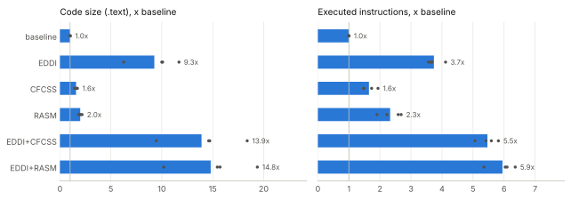
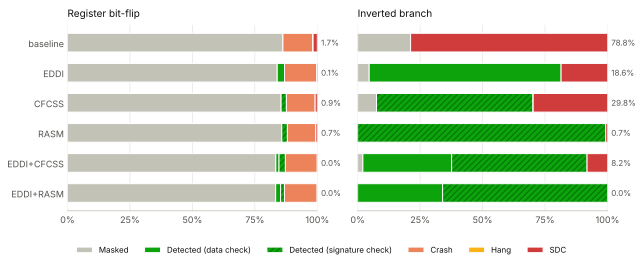

# Summary

ASPIS is a set of LLVM passes that hardens programs against soft errors by
duplicating the computation (EDDI and its variants) and by checking the
control flow with signatures (CFCSS, RASM and others). The goals of the
project were (1) to protect C applications with ASPIS, (2) to verify the
protection with fault injection and (3) to integrate the applications into
the ASPIS main branch for regression testing.

- We wrote **four small self-checking applications**: AES-128 encryption, an
  FFT, Huffman compression and a PID speed controller.
- We added them to the official test harness of ASPIS, which builds every
  test with 55 combinations of techniques. On the main branch the first
  version of the applications passed only 100 of the 220 builds: EDDI, sEDDI
  and FDSC, the techniques that duplicate the whole program, made all four
  crash. We found the **bug in EDDI** behind the crashes, isolated it in a
  five-line program and avoided it in our code. All the 220 builds now pass.
- We injected faults with **gdb**, driven by a short script, after counting
  the executed instructions with valgrind, and ran **28,000 experiments**
  that flip a bit in a register or invert a conditional jump, on six
  hardening configurations.
- EDDI reduces the silent data corruptions (SDCs) caused by register
  bit-flips from 1.43% to 0.20% of the faults, at 3.7 times the executed
  instructions. RASM detects 99.1% of the inverted branches, CFCSS only
  62.0%. The campaign also revealed a **bug in RASM**: it did not check the
  blocks created by EDDI, so EDDI combined with RASM missed more inverted
  branches than RASM alone (10.2% of SDCs instead of 0.88%). We fixed it
  with a one-line change; with the fix the combination leaves no SDC in 4000
  inverted branches.

The fix of RASM and the test entries are ready as two patches for the ASPIS
repository, and the EDDI bug as a bug report (`aspis-integration/`). All the
code, the raw results and the scripts that produce every table and figure
are in the repository (Appendix A). The use of a large language model is
declared in Section 8.

# 1. Background

## 1.1 Soft errors and software-implemented fault tolerance

A particle strike can flip a bit in a register or in a memory cell. The
hardware is not damaged, but the program may compute a wrong result without
noticing it (a *silent data corruption*, SDC), crash, or hang.
Software-Implemented Hardware Fault Tolerance (SIHFT) protects programs that
run on unprotected hardware by transforming their code. *Data-flow*
techniques duplicate the computation and compare the two copies at selected
points. *Control-flow checking* (CFC) techniques give each basic block a
signature and check at run time that the blocks are executed in an order
allowed by the control-flow graph.

## 1.2 ASPIS

ASPIS (*Automatic Software-based Protection and Integrity Suite*, from the
Greek word for shield; Baroffio et al., ACM TODAES 2024) implements these
transformations as passes on the LLVM intermediate representation (IR). Its
driver, `aspis.sh`, compiles the sources to IR without optimisations, links
them, and runs:

1. `FuncRetToRef`: every function that returns a value gets a `_ret`
   version that writes the result through an extra pointer parameter, so that
   the two copies of the program can receive two copies of the result;
2. a data protection pass. **EDDI** (Oh et al., 2002) duplicates every
   instruction and compares the two copies before stores, calls and
   branches; **sEDDI** does not compare before stores; **FDSC** compares only
   at the basic blocks that have several predecessors; **REDDI** hardens only
   the functions and globals annotated with `to_harden` and what they use;
3. a control-flow checking pass. **CFCSS** (Oh et al., 2002) updates a
   run-time signature with an XOR at the entry of each block and compares it
   with the signature of the block. **RASM** (Vankeirsbilck et al., 2017)
   checks the signature at the entry of each block and, before leaving the
   block, adds a value that depends on the successor that is taken. ASPIS also
   offers inter-RASM and RACFED, variants of RASM;
4. `DuplicateGlobals`, which keeps the duplicated global variables
   consistent.

Every hardened function `f` gets a version `f_dup` that takes each parameter
twice and executes both copies of the computation; each global variable gets
a `_dup` copy. When a check fails the program calls `DataCorruption_Handler`
(data checks) or `SigMismatch_Handler` (signature checks), two functions that
the application must define.

As an example, this is how EDDI transforms
`int scale(int v) { return v * g; }`, where `g` is a global variable. The
result is returned through a pointer (`FuncRetToRef`), every parameter comes
twice (`%0` and `%2` are the two copies of `v`, `%1` and `%3` of the result
pointer), every load and multiplication is executed twice, and the two
results are compared before they leave the function:

```llvm
define void @scale_ret_dup(i32 %0, ptr %1, i32 %2, ptr %3) {
VerificationBB:
  %4 = alloca i32                       ; v
  %5 = alloca i32                       ; its copy
  store i32 %2, ptr %4
  store i32 %0, ptr %5
  %6 = load i32, ptr %4
  %7 = load i32, ptr %5
  %8 = load i32, ptr @g
  %9 = load i32, ptr @g_dup
  %10 = mul nsw i32 %6, %8
  %11 = mul nsw i32 %7, %9
  %12 = icmp eq i32 %10, %11            ; consistency check
  br i1 %12, label %13, label %ErrBB
13:
  store volatile i32 %10, ptr %3        ; "return" both copies
  store volatile i32 %11, ptr %1
  ret void
ErrBB:
  call void @DataCorruption_Handler()
  unreachable
}
```

## 1.3 The test harness of ASPIS

The tests of ASPIS are listed in `testing/config/tests.toml`. The harness
(`pytest test.py` in `testing/`) compiles each test with the 11 data
protection options (none, EDDI and its variants `--multiple-errbb` and
`--coarse-grained`, REDDI and the same variants, sEDDI, FDSC) combined with
the 5 control-flow options (none, CFCSS, RASM, RACFED, inter-RASM), runs it,
and compares its output with the output of the program compiled by
`clang++` without ASPIS. A test can exclude some techniques with a
`black_list`.

# 2. The applications

We wrote four small applications representative of the code that runs on
the embedded systems targeted by SIHFT. They follow the same rules:

- they are **deterministic** and **self-checking**: they print a summary of
  their results, compare them with known answers and end with `SUCCESS` or
  `FAIL` (exit status 0 or 1);
- they define the two **fault handlers**, which print
  `FAULT_DETECTED: DataCorruption` or `FAULT_DETECTED: SigMismatch` on
  stderr and exit with status 2 or 3, so that a detection is easy to
  recognise;
- they are valid **C and C++**, because the harness compiles the reference
  program with `clang++`;
- they are **short**: they execute less than a million instructions, so that
  thousands of fault injections take minutes;
- they use only the C standard library and are released under the **MIT
  license**, so that they can enter the ASPIS repository.

| Application | What it does | Lines | Instructions |
|---|---|---:|---:|
| `aes128` | AES-128 encryption (FIPS-197): known-answer test, encryption and decryption of 64 bytes in CBC mode; the S-boxes are computed at start-up | 329 | 645,656 |
| `fft` | radix-2 FFT of 256 points: dominant frequencies, Parseval's theorem, inverse transform | 186 | 367,747 |
| `huffman` | Huffman compression and decompression of a text, with a binary min-heap | 225 | 170,962 |
| `pid_control` | closed-loop speed control of a DC motor with a PID controller, 2000 steps | 159 | 477,379 |

: The applications. *Instructions*: x86-64 instructions executed in the
program's own code (excluding the C library) by the unprotected program,
counted by valgrind (Section 4.2).

# 3. Hardening the applications

## 3.1 Results of the harness

We added the four applications to `tests.toml` and ran the harness on the
main branch of ASPIS (commit `b66a090`, LLVM 21.1.8, x86-64 Linux).

{{table:compat_apps}}

: Builds of the four applications that pass the harness (4 applications x 5
control-flow options for each data protection option): the first version
of the applications on the main branch, the final version on the main
branch, and the final version with our patches (Section 6).

With the first version, the control-flow techniques worked on all the
applications. REDDI passed too, but only because our applications have no
`to_harden` annotation, so REDDI hardens nothing. The three techniques that
duplicate the whole program, EDDI (in its four variants), sEDDI and FDSC,
made all the applications crash with a segmentation fault.

## 3.2 A bug in EDDI

With a debugger we found that the faulting instruction was always an 8-byte
store right after a call to `printf`, writing into a string literal, which is
in read-only memory (`.rodata`): `"kat ct: "` in `aes128`, a label received as
a parameter and printed with `printf("%s", label)`, and the string chosen by
`ok ? "OK" : "MISMATCH"` or `ok ? "SUCCESS" : "FAIL"` in the other three.
The five-line program `aspis-integration/reproducers/string_literal.c`
reproduces the crash:

```c
static void show(const char *label) { printf("%s\n", label); }
int main(void) { show("hello"); return 0; }
```

**Cause.** When a hardened function calls a function that has no `_dup`
version, like `printf`, the callee may write through its pointer arguments,
and it updates only the original copy of the data. After the call EDDI
therefore copies each pointed value from the original to the duplicate
(`fixFuncValsPassedByReference` in `passes/EDDI.cpp`). The copy loads and
stores a pointer-sized value (8 bytes), whatever the pointed type is. When
the argument points to a string literal, the two copies of the pointer are
the same read-only address (the two copies of the parameter `label`, or of
the `?:`), so the store makes the program crash. The fixed size of the copy
is wrong in general too: it overflows objects smaller than 8 bytes and
synchronises only the first 8 bytes of larger ones.

**What we did.** The applications now print only literal strings
(`printf("SUCCESS\n")` instead of `printf("%s\n", ok ? "SUCCESS" : "FAIL")`),
with the same output; a comment at the top of each file explains why. With
this change all the 220 builds pass on the main branch (table above). We
did not change EDDI: the bug is described, with the reproducer, the analysis
and a possible fix, in `aspis-integration/bug_report.md`, ready to be
reported to the maintainers.

## 3.3 No regressions

The only change to ASPIS of this project is the fix of RASM of Section 5.4.
On the 48 tests that were already in ASPIS the harness gives exactly the
same results with and without it:

{{table:compat_suite}}

: Builds of the 48 existing tests of ASPIS (48 x 55 = 2640), on the main
branch and with our patches.

The 154 skipped builds are excluded by the `black_list` of their tests. The
33 failures are all the builds of `cpp_complex` that are not blacklisted: on
our system the reference program does not compile, because the test uses
`std::powf`, which the C++ library we used (libstdc++ 13) does not declare.
The failure does not depend on ASPIS.

# 4. Fault injection

## 4.1 Fault models

We emulate a single transient fault in the processor while the program runs
its own code (never in the C library or in the dynamic loader, which ASPIS
does not harden). An experiment picks a *dynamic* instruction uniformly at
random, i.e. a random instant of the execution: an instruction with a
probability proportional to the times it is executed, then one of its
executions. It stops the program right before it and injects one fault:

- **register bit-flip** (`reg`): one random bit of one of the 16 general
  purpose registers (`rax` ... `r15`) is inverted;
- **inverted branch** (`branch`): the instant is chosen among the executions
  of conditional jumps, and the jump goes to the successor that the
  condition did not select. This is the effect of a fault in the flags or in
  the branch unit, and the classic error that control-flow checking should
  detect.

## 4.2 Injecting the faults with gdb

We did not write an injector: the experiments use two standard tools, gdb and
valgrind, driven by two short Python scripts.

- **Golden run.** Each program runs once without faults under valgrind
  (`callgrind`), which counts how many times each instruction of the program
  is executed; `objdump` tells which ones are conditional jumps. The output of
  a normal run is the reference (the *golden output*).
- **Experiment.** `fault_injection/gdb_inject.py` (about 80 lines, half of
  them comments) runs inside gdb. It receives an instruction and one of its
  executions, the *k*-th, drawn from the counts of the golden run, and puts a
  breakpoint on that instruction with an *ignore count* of *k*-1, so that gdb
  stops the program right before the *k*-th execution (gdb disables address
  randomisation, so the addresses are the same in every run). For a register
  bit-flip it changes the register (`set $rax = ...`); for an inverted
  branch it executes the jump (`stepi`), sees where it went and moves the
  program counter to the other successor. Then the program continues, and a
  watchdog kills it if it does not end in time.

Each experiment is classified, in this order, as: *hang* if after the fault
the program did not end within 20 times its normal run time (at least 1 s);
*crash* if it was killed by a signal; *detected (data)* or *detected (CFC)*
if one of the two handlers reported the fault; *masked* if its output and exit
status are the same as in the golden run; *SDC* otherwise, which includes a
wrong output and the program's own check printing `FAIL`.

## 4.3 The campaign

`fault_injection/campaign.py` builds each application with each
configuration, records its size, does the golden run and runs the
experiments, four at a time. We used six configurations: the unprotected
`baseline` (the same `aspis.sh` pipeline without transformations), EDDI,
CFCSS, RASM, and EDDI combined with CFCSS and with RASM, built with ASPIS
`b66a090` plus our fix of RASM. For each application, configuration and fault
model we injected 500 faults, drawn with a seed derived from the names:
**24,000 experiments**. To measure the effect of the RASM bug (Section 5.4),
EDDI+RASM was also run with ASPIS `b66a090` without the fix: 4,000 more
experiments. Each proportion is given with its 95% confidence interval
(Wilson score interval).

# 5. Results

## 5.1 Cost of the protection

{{table:cost}}

: Size of the code (`.text`) and executed instructions relative to the
baseline (geometric mean over the four applications), and number of
consistency checks inserted by EDDI in the four applications.



Data duplication is the expensive part. EDDI executes 3.74 times the
instructions of the unprotected program (geometric mean over the
applications, between 3.56x and 4.12x): every instruction is executed twice,
and each of its 1283 checks adds comparisons and a branch. The code grows
much more than the execution (9.27x), because every function exists in up
to four versions (original, `_ret`, `_dup`, `_ret_dup`), each check splits a
block, and without optimisations every value goes through the stack. The
control-flow techniques cost less: 1.65x the executed instructions for CFCSS
and 2.33x for RASM. Combined with EDDI the costs add up: 5.46x with CFCSS and
5.95x with RASM.

## 5.2 Register bit-flips



{{table:outcomes_reg}}

: Register bit-flips: outcome of the injections (% of n faults, pooled over
the four applications), with the 95% confidence interval of the SDC rate.

Register bit-flips are mostly harmless: in the unprotected programs 86.5%
of them are masked (the register was not in use, or was overwritten before
being read), 12.0% crash the program (for example a corrupted address) and
1.43% silently corrupt the output. EDDI leaves 0.20% of SDCs, 7 times fewer.
Its checks detect only 3.1% of the faults, but these are the dangerous ones:
a wrong value is caught before it reaches a store, a call or a branch. The
control-flow techniques alone leave 0.80% (CFCSS) and 0.60% (RASM), since a
signature only sees the bit-flips that change the path of the program.
Combined with EDDI they leave one or two SDCs in 4000 faults (0.03% and
0.05%).

## 5.3 Inverted branches

{{table:outcomes_branch}}

: Inverted branches: outcome of the injections (% of n faults, pooled over
the four applications).

Inverted branches are the most harmful faults: 80.3% of them corrupt the
output of the unprotected programs, because the results depend on how many
times the loops run and on which path the data-dependent branches take.

EDDI and CFCSS detect almost only the inversions of the jumps of their own
checks. Counted on the golden runs with `fault_injection/check_jumps.py`,
76.3% of the conditional jumps executed by the programs hardened with EDDI
belong to its checks, and 62.4% with CFCSS: an inverted check jumps to the
error handler. These shares are close to their detection rates (78.2% and
62.0%). The inversions of the program's own branches are not seen. EDDI
compares the two copies of the condition before the jump, but then executes
a single jump, so both copies of the data follow the wrong path; CFCSS only
checks that the program follows an edge of the control-flow graph, and the
wrong successor of a branch is an edge too. They leave 17.8% and 30.0% of
SDCs.

RASM detects 99.1% of the inverted branches: before leaving a block it
updates the signature using the same condition as the jump, so a jump in the
other direction reaches a block that expects a different signature. All its
35 SDCs (0.88%) come from a single conditional jump of `pid_control` that is
not a branch of the IR: in `load_at`, `return (k >= 1200 && k < 1300) ?
1.5f : 0.0f;` is a `select` between two floats, which the x86 back-end
implements with a jump when it does not optimise. No technique working on
the IR can see that jump. EDDI with CFCSS leaves 7.8% of SDCs; EDDI with RASM
none, because EDDI duplicates the `select` too, and a wrong jump in one copy
makes the two copies differ.

## 5.4 A bug in RASM, found by the fault injection

With ASPIS `b66a090`, without our fix, EDDI+RASM left 10.2% of SDCs with
inverted branches, much more than RASM alone (0.88%), although it adds the
checks of EDDI to those of RASM. With `fault_injection/sdc_sites.py`, which
maps the SDCs to the instructions where the faults were injected and shows
the successors of the jumps, we found that all the 407 SDCs happened at
conditional jumps towards blocks that start by writing a constant into the
signature of RASM, instead of checking it.

The cause is in `RASM.cpp`: a block whose name contains "verification" is
treated as a block created by RASM itself, and its signature is reset to the
expected value without a check. The test was meant for the blocks of RASM
(`RASM_Verification_BB`), but it also matches the `VerificationBB` blocks
created by EDDI, which are the successors of most blocks of a program
hardened with EDDI. A jump into the wrong one of them re-synchronised the
signature and went undetected:

```llvm
  br i1 %8, label %VerificationBB2, label %VerificationBB3
VerificationBB2:                        ; created by EDDI
  store volatile i32 24, ptr %2         ; RASM resets the signature, no check
```

**Fix** (patch 0001). A one-line change: only the blocks whose name starts
with `RASM_` (and the landing pads of C++ exceptions) are exempted, so the
`VerificationBB` blocks get the entry check like any other block. RACFED had
the same code and is fixed in the same way. With the fix EDDI+RASM leaves no
SDC among the 4000 inverted branches, and its signature checks detect 65.0%
of them instead of 35.1%; the rest is detected by the checks of EDDI.

{{table:before_after}}

: EDDI+RASM before and after the fix of RASM (4000 faults per row).

## 5.5 Per application

{{table:sdc_reg_per_app}}

: SDC rate (%) of register bit-flips per application (1000 faults each).

{{table:sdc_branch_per_app}}

: SDC rate (%) of inverted branches per application (1000 faults each).

The unprotected applications have similar SDC rates for register bit-flips,
between 1.1% (`fft`, `huffman`) and 1.9% (`aes128`), and EDDI brings all of
them to 0.3% or less. With 1000 faults per application the differences
between the applications are not significant: the 95% intervals overlap
(1.2-2.9% for `aes128`, 0.6-2.0% for `fft`). For inverted branches the
picture is the same in all the applications; the SDCs left by RASM are all
in `pid_control` (Section 5.3).

# 6. Integration into ASPIS

`aspis-integration/` contains what is needed to merge the work into the main
branch of ASPIS:

| File | Content |
|---|---|
| `patches/0001-...` | fix(RASM, RACFED): check the signature in the verification blocks of EDDI (Section 5.4; the same code is in RACFED) |
| `patches/0002-...` | test: add the four applications to `testing/tests/c/applications/` and to `tests.toml` |
| `bug_report.md` | the EDDI bug of Section 3.2, with the reproducer `reproducers/string_literal.c` |

The patches were produced with `git format-patch` and apply with `git am`
on `b66a090`. With them, `pytest test.py` runs our applications with the 55
combinations together with the existing tests, so that future changes of
ASPIS are checked on them too. Nothing has been submitted yet.

# 7. Limitations

- The fault models cover the general purpose registers and the conditional
  jumps only. Faults in the floating-point registers (used by `fft` and
  `pid_control`), in memory, and multiple faults are not injected.
- 1000 faults per application and configuration give wide intervals on the
  rates of single applications (for example 1.2-2.9% for the register SDC rate of `aes128`); the
  pooled rates (4000 faults) are more precise.
- We compare the cost with the executed instructions, not with the run
  time: the applications run for a few milliseconds, too little for precise
  time measurements.
- The control-flow techniques work on the IR, so they cannot see the jumps
  created by the back-end, such as the one of the floating-point `select` in
  `pid_control` (Section 5.3); only data duplication catches them.
- Our applications avoid the EDDI bug of Section 3.2 instead of fixing it, so
  they do not test that part of EDDI; the reproducer should become a test
  once the bug is fixed.

# 8. Declaration on the use of large language models

The supervisors allowed the use of AI tools ("you can do whatever you want
with IA even the whole project"), asking to "declare in the final report
whether you have used LLMs and for what purpose". This project was carried
out with extensive use of an LLM-based coding agent, Claude (Anthropic),
through Claude Code. The agent was used for:

- writing the applications and the fault-injection and analysis scripts;
- running the experiments: building LLVM and ASPIS, the test harness, the
  fault-injection campaign;
- debugging ASPIS: isolating the failures, writing the reproducer, finding
  the causes, writing the fix of RASM and the bug report of EDDI;
- writing this report, its tables and figures.

The students defined the goals and the scope of the project, supervised the
work, and are responsible for checking the results and the content of this
report.

# Appendix A. Reproducing the results

| Path | Content |
|---|---|
| `benchmarks/` | the four applications |
| `aspis-integration/` | the patches for ASPIS, the test entries, the bug report and its reproducer |
| `fault_injection/gdb_inject.py` | one experiment, run inside gdb |
| `fault_injection/campaign.py`, `campaign.toml` | the campaign: builds, golden runs with valgrind, experiments, results |
| `fault_injection/analyze.py` | tables and figures |
| `fault_injection/sdc_sites.py`, `check_jumps.py` | where the SDCs happened, and how many executed jumps belong to checks (Sections 5.3, 5.4) |
| `results/` | logs of the harness, results of the campaign |
| `report/` | this report (`report.md`, built by `build.py`) |

```bash
# 1. LLVM 21.1.8 and ASPIS with the patches
curl -LO https://github.com/llvm/llvm-project/releases/download/llvmorg-21.1.8/LLVM-21.1.8-Linux-X64.tar.xz
tar xf LLVM-21.1.8-Linux-X64.tar.xz
git clone --recursive https://github.com/HEAPLab/ASPIS && cd ASPIS && git checkout b66a090
git am <repo>/aspis-integration/patches/*.patch
cmake -B build -G Ninja -DLLVM_DIR=<llvm>/lib/cmake/llvm && cmake --build build
# 2. the official harness (llvm_bin in testing/config/llvm.toml)
cd testing && pytest test.py -v > harness.log
# 3. fault injection (needs gdb and valgrind; paths at the top of campaign.toml)
python3 <repo>/fault_injection/campaign.py <repo>/fault_injection/campaign.toml
# 4. tables, figures and this report
python3 <repo>/fault_injection/analyze.py --campaign <repo>/results/fault_injection \
    --before <repo>/results/fault_injection/before_fix --out <repo>/report \
    --harness "first version, master=<repo>/results/compatibility/harness_master_first_version.log.gz" \
    --harness "final, master=<repo>/results/compatibility/harness_master.log.gz" \
    --harness "final, with patches=<repo>/results/compatibility/harness_fixed.log.gz"
python3 <repo>/report/build.py
```

The campaign takes about 20 minutes on a 4-core virtual
machine. The run without the fix of RASM uses ASPIS `b66a090` without
patches and the EDDI+RASM configuration alone. For the harness on the main
branch, our entries are added with `pytest test.py --tests-file
config/tests.toml <repo>/aspis-integration/flc_tests.toml`.

# References

1. D. Baroffio, F. Reghenzani, W. Fornaciari. *Enhanced Compiler Technology
   for Software-based Hardware Fault Detection*. ACM Transactions on Design
   Automation of Electronic Systems 29(5), article 91, 2024.
   doi:10.1145/3660524.
2. N. Oh, P. P. Shirvani, E. J. McCluskey. *Error detection by duplicated
   instructions in super-scalar processors*. IEEE Transactions on
   Reliability 51(1), 2002. doi:10.1109/24.994913.
3. N. Oh, P. P. Shirvani, E. J. McCluskey. *Control-flow checking by software
   signatures*. IEEE Transactions on Reliability 51(1), 2002.
   doi:10.1109/24.994926.
4. J. Vankeirsbilck, N. Penneman, H. Hallez, J. Boydens. *Random Additive
   Signature Monitoring for Control Flow Error Detection*. IEEE Transactions
   on Reliability 66(4), 2017. doi:10.1109/TR.2017.2754548.
5. ASPIS repository, https://github.com/HEAPLab/ASPIS (commit `b66a090`).
